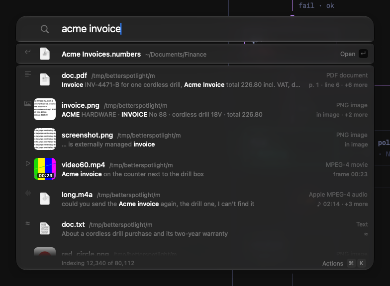

<p align="center"></p>

<h1 align="center">Hunch</h1>

<p align="center">Find the thing you half remember. Apps, files and folders, and the words inside them, on your Mac, offline.</p>



 
 

## Features

- **Names**: apps, files, folders and System Settings panes ("login items", "battery", "touch bar"), ranked as you
  type, keyboard-first (↑/↓, ↵, ⌘↵, ⌘1–9, Tab to narrow; Tab on a folder searches inside it, ⇧Tab goes up a
  level). What you open after a query ranks higher the next time you type it. Files open in the app macOS would
  use: your default for the type, or the file's own "Open with" choice.
- **Contents**: text inside documents (PDF, Office, RTF, plain text and code), text inside images (OCR), text and frames
  inside videos, and speech inside audio and video.
- **Meaning**: semantic matches for text and images through EmbeddingGemma 2 and its image projector, on-device.
- **Filters**: `in:Folder`, `name:`, `ext:`, `kind:` (`kind:image`, `kind:pdf`) and `modified:` (`today`, `yesterday`,
  `week`, `month`, `year`) operators, combined with any search text.
- **Actions**: open, open with, reveal in Finder, Quick Look, copy path, pin to Favorites, open a folder in your
  terminal (⌘K shows them all). Hold ⌥ for the alternates: Copy File instead of Copy Path, Force Quit instead of
  Quit, Get Info (⌘I) instead of Show in Finder, Share instead of Open With, Move to Trash (⌘⌫) instead of Exclude.
  Drag a result out of the panel to drop the file into Finder, Mail or a chat.
- **Liquid Glass panel**: one slab of system glass that follows Light/Dark, Increase Contrast, Reduce Transparency and
  Reduce Motion.

## Privacy

- Everything runs on your Mac. There is no telemetry and no account.
- Network calls: the optional model download from Hugging Face and the update check against GitHub Releases (at
  most once a day; turn it off in Settings → About). Neither sends anything about your files.
- The model lives in `~/.hunch/models`, the index in `~/Library/Application Support/Hunch`. Files that look like
  secrets are indexed by name only.

## Install

1. Download `Hunch-<version>-arm64.zip` from the Releases page, open it and drag Hunch.app to
   /Applications.
2. Double-click it. macOS says it "cannot verify the developer". Click **Done**.
3. Open **System Settings → Privacy & Security**, scroll to Security, find "Hunch was blocked", click
   **Open Anyway** and authenticate.
4. Or, in Terminal: `xattr -dr com.apple.quarantine /Applications/Hunch.app`.

Updates install from inside the app: Settings → About → **Update and Relaunch**, or the menu bar item. Hunch downloads
the release from GitHub, checks it against the release's `SHA256SUMS.txt` and its code signature, replaces itself and
relaunches. The index, the model and your settings stay. No "Open Anyway" is needed for updates.

Permissions: Full Disk Access is optional (it widens what can be indexed); Speech Recognition is only needed for
transcripts of audio and video.

## The model (optional)

Semantic search uses EmbeddingGemma 2 by Google DeepMind (Apache-2.0), Q8_0 GGUF files from
`ggml-org/embeddinggemma-2-GGUF` on Hugging Face at a pinned revision, checked by SHA-256:

| File | Size |
|---|---|
| `embeddinggemma-2-Q8_0.gguf` (text) | 310 MB |
| `mmproj-embeddinggemma-2-Q8_0.gguf` (images) | 555 MB |

That is 865 MB in total. Onboarding offers the download into `~/.hunch/models`, and Hunch loads it only from there;
you can also choose the files by hand (they are copied there). Without the model, name and content search still work.

## Build from source

Requirements: Apple silicon, macOS 26 or later, Xcode 27 or the Command Line Tools with Swift 6.4.

```sh
git clone <this repository>
cd Hunch
swift build
./Scripts/test.sh          # unit and integration tests
./Scripts/make-app.sh      # build/Hunch.app, ad-hoc signed
./Scripts/install.sh       # optional: copy it to /Applications
```

## Benchmarks

Measured on an Apple M5 Pro with 24 GB of RAM, macOS 27.2, release build, during the 1.0.0 verification runs
(2026-10-27, seven runs, with `spotlightknowledged` using one core in the background). These are measurements, not
targets. Panel numbers come from `Scripts/perf-gate.sh` (the app's `--measure` mode, 20 shows and 20 typed
characters per run); engine numbers come from `hunch-bench` on a synthetic corpus of 200,000 names and 100,000
vectors.

| Metric | p50 | p95 |
|---|---|---|
| Hotkey → panel on screen | 15.5–16.6 ms | 18.4–24.0 ms |
| Keystroke → first results on screen | 20.8–21.9 ms | 24.4–32.8 ms |
| Results applied → frame committed | 8.9–10.4 ms | 13.4–15.5 ms |
| Name search, 200k items | | 4.1 ms |
| Vector search, 100k vectors | | 1.9 ms |
| Query embedding | | 5.1 ms |

| Metric | Value |
|---|---|
| Idle CPU, panel hidden | 0.05 % |
| CPU and memory added by hovering rows | 0 % and 0.0 MB |
| Memory, idle (model not loaded) | 68 MB |
| Memory, searching by meaning (app + model helper) | 69 + 220 MB |
| Memory, indexing (app + model helper) | 69 + 300 MB |
| Memory after the model unloads | 69 MB (the helper exits) |
| Crawl throughput | 39,700 items/s |
| Document chunks embedded | 779 /s |

Panel show (target 14 ms) and frame commit (target 12 ms) are still over their p95 targets; see the open performance
issue.

## Comparison (as of October 2026)

| | Content search | OCR in images | Speech | Semantic | Offline | Open source | Price | Idle memory | App size | Model download |
|---|---|---|---|---|---|---|---|---|---|---|
| macOS Spotlight | yes | yes | no | n/v | yes | no | free | n/p | built in | none |
| Raycast | via Spotlight | no | no | no | n/v | no | free / paid | 200–300 MB (v1), 350–450 MB (v2) [¹](https://www.raycast.com/blog/a-technical-deep-dive-into-the-new-raycast) | n/p | none |
| Alfred | via Spotlight | no | no | no | yes | no | free / paid | n/p ("tiny") [²](https://www.alfredapp.com/help/why-choose-alfred) | under 3 MB (v3) [³](https://www.alfredapp.com/changelog/v3) | none |
| DigUp | yes | yes | no | yes | yes | yes (MIT) | free | n/p (model process quits when done) [⁴](https://github.com/ARahim3/DigUp) | about 20 MB [⁴](https://github.com/ARahim3/DigUp) | 865 MB |
| Tinycast | no | no | no | no | yes | yes (AGPL-3.0) | free | under 100 MB [⁵](https://github.com/abue-ammar/tinycast) | n/p | none |
| Hunch | yes | yes | yes | yes | yes | yes (MIT) | free | 68 MB (+220 MB while the model runs) | 18 MB (5.9 MB zip) | 865 MB |

"n/v" = not verified. "n/p" = the project publishes no figure. Memory and size figures for other apps are what each
project publishes about itself, from different machines and methods; read them as rough sizes, not a benchmark.
Hunch's figures are measured (see Benchmarks) as physical footprint, the "Memory" column of Activity Monitor. The
model runs in a helper process inside the app, "Hunch Helper" in Activity Monitor, which starts when you search by meaning or when new files need
indexing, and exits after 5 idle minutes, returning all of its memory. Spotlight's own indexing processes (`mds_stores`, `mdworker_shared`) run on every Mac
whether or not you use another launcher. This table makes no claims about other apps' speed.

## FAQ

- **Why the name?** You rarely remember a file's exact name, only a hunch of what was in it. Hunch finds it from that.
- **Why not just Spotlight?** Hunch searches meaning as well as words, reads speech and video frames, and
  never leaves your Mac.
- **Why "Open Anyway"?** The app is not notarized (no Developer ID yet). See Install.
- **Why do permissions reset after an update?** Ad-hoc signatures change with each build, and macOS ties grants to the
  signature.
- **Does it upload my files?** No.
- **Disk and memory?** About 68 MB at rest. Searching by meaning starts a helper process inside the app ("Hunch Helper", about
  220 MB, 300 MB while indexing) that exits after 5 idle minutes. The index size depends on your files.
- **Why the Q8_0 model and not a smaller quant?** We compared every EmbeddingGemma 2 GGUF on Hugging Face against
  BF16 with `Scripts/quant-eval.py` (50 queries, 400 documents, October 2026). Q8_0 (ggml-org and Unsloth, same
  weights) keeps 97.8 % of each query's top 10 and 100 % of top hits. The best smaller one, Unsloth UD-Q6_K_XL
  (249 MB), keeps 94.6 % and 96 %; the 4- and 5-bit files keep 74–91 %. A smaller file would not lower memory either:
  the weights are mapped from disk, so the footprint with the model loaded measured 282–284 MB for Q8_0, Q6_K and Q4_K
  alike (in-process run).
- **Intel Macs?** No, Apple silicon only.
- **Uninstall?** Quit it, then delete `/Applications/Hunch.app`,
  `~/.hunch`, `~/Library/Application Support/Hunch` and the app's preferences in `~/Library/Preferences`.

## Credits

- [llama.cpp / ggml](https://github.com/ggml-org/llama.cpp) (MIT) for on-device inference.
- EmbeddingGemma 2 by Google DeepMind (Apache-2.0).

Spotlight, macOS and Apple silicon are trademarks of Apple Inc. This project is not affiliated with Apple.

## License

MIT, see [LICENSE](LICENSE). Third-party notices are in [THIRD_PARTY_NOTICES.md](THIRD_PARTY_NOTICES.md).
